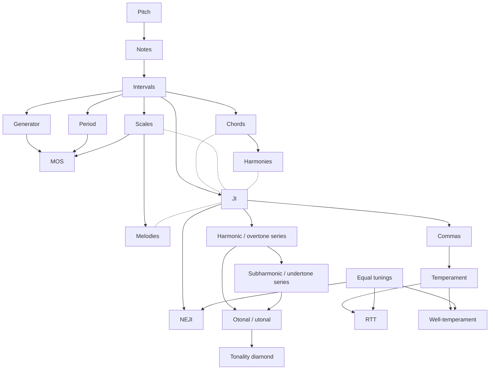

# Xenharmonic Platform: Project Guide

The main guiding document for the Nick Vuci xenharmonic platform. It records what the platform is, what has been decided, and what is still open. Last updated 2026-11-11.

**End goal:** consolidate everything in Nick's GitHub repos into one core program built on xen-tun-core, preserving as much existing work as possible. User-facing features are kept; the 15-odd-limit atlas stays whole for now and is pruned later. Technical details are left to the developer's (Claude's) judgment and recorded in ARCHITECTURE.md or ROADMAP.md.

## What the platform is

A platform on nickvuci.com for learning, exploring, practicing, researching and composing xenharmonic music, built so theory is always tied to hearing and making music. Four environments share one mathematical, musical-data and audio foundation.

1. **Classroom.** A nonlinear concept map. Each concept is one short lesson, and students may enter in any order; prerequisites guide but never lock.
2. **Studio** (formerly the workstation, at `studio/`). The central creative space, exploration-first rather than a conventional DAW. Discovery comes before arrangement. Piano roll, notation, trackers, lattices and HexBoard layouts are views of the same shared musical objects.
3. **Practice Room** (`practice/`). Focused training tools (interval, chord and scale recognition, pitch, rhythm, instrument practice) with adaptive difficulty and tracking. Musicianship lives here, not in separate concept nodes. The odd-limit ear trainer is its first tool.
4. **Reference Library** (`library/`). Searchable, filterable and computational: JI intervals, limits, EDOs, temperaments and commas, MOS, chords, comma pumps. It answers constrained queries with lazy computation rather than huge fixed lists, and its objects transfer into the Studio. Its MVP is the whole 15-odd-limit atlas.

### Framework

Standard musicianship applied to the four pillars of xen theory, woven as a network: just intonation, equal tunings (EDOs), generated collections (MOS), and linear temperaments. Lessons teach concepts and how they connect, not individual EDOs, temperaments or limits.

### Audience

Three levels, each with its own entry point on the map: complete beginner, knows music theory, knows some xen theory.

### Lesson structure

Every lesson is built from the JI lesson as its template, is bite-sized and teaches a concept together with a practical use of it; there are no separate "technique" nodes. All lessons follow five stages:

1. **Video:** a concise explanation of one concept.
2. **Lab:** a playful, focused interactive demonstration.
3. **Composition:** a creative task in a lesson-configured view of the real Studio.
4. **Confirmation:** questions or a practical assessment.
5. **Completion:** a last slide linking to the map, the Studio, the concept's Xen Wiki page and its Reference Library pages.

Labs are purpose-built (sliders, drones, Lissajous figures) and need not resemble the Studio; they only share its math and audio. The composition stage is a real Studio project, so a student can open it unchanged in the full Studio. Labs can hand selected discoveries to it.

Example, JI lesson: the composition stage shows a scale builder with 15-limit intervals, a line/bar diagram, presets such as Ptolemy's intense diatonic, play, save and .scl/.kbm export, then a piano roll (8 bars of 4/4) on the saved scale.

Saved fragments, scales, chords, temperaments, comma pumps, layouts and compositions can be reused later. Prior work never constrains new work.

The existing classroom framework, lesson content, video and interactive JI lab are preserved and integrated, not recreated.

## MVP concept map

21 concepts. Solid arrows mean "leads to"; dotted lines mean "related". Pitch and Equal tunings are the two starting points. This map replaces all earlier concept-list drafts. `map.js` draws it on the concept map page, and `conceptMap.md` lists it as text.

| Concept | Leads to | Related |
| --- | --- | --- |
| Pitch | Notes | — |
| Notes | Intervals | — |
| Intervals | Chords, Scales, JI, Generator, Period | — |
| Chords | Harmonies | JI |
| Scales | MOS, Melodies | JI |
| Generator | MOS | — |
| Period | MOS | — |
| Harmonies | — | JI |
| Melodies | — | JI |
| JI | Harmonic/overtone series, Commas, NEJI | Chords, Scales, Harmonies, Melodies |
| Commas | Temperament | — |
| Harmonic/overtone series | Subharmonic/undertone series, Otonal/utonal | — |
| Subharmonic/undertone series | Otonal/utonal | — |
| Otonal/utonal | Tonality diamond | — |
| Temperament | RTT, Well-temperament | — |
| Equal tunings | RTT, Well-temperament, NEJI | — |
| MOS, Tonality diamond, NEJI, RTT, Well-temperament | — | — |

JI limits are taught as one lesson within JI; individual limits do not get lessons of their own.

## Scope and conventions

- JI up to the 15-odd-limit.
- EDOs up to about 72.
- MOS with 5–9 notes ("diatonics"), named only by xL ys pattern.
- Major linear temperaments up to the 13-limit. Core set: meantone (plus septimal), superpyth, mavila, porcupine, magic, pajara, orwell, miracle.
- Flexible applications (e.g. shifting MOS generator or period) are outside the core.
- EDO intervals appear as steps\EDO, then cents, then nearest JI, then standard name (Xen Wiki name if there is no conventional one).
- No "k-step" terminology.
- "Generated collections" is the broad category; MOS are a special class, taught after it.

These limits are curriculum scope, not engine limits. The engine supports exact rationals, monzos, arbitrary primes and subgroups, any EDO and non-octave periods, and assumes neither 12-TET nor octave equivalence. Where traditions define a term differently, the chosen interpretation is documented.

## Architecture

Five layers; a mathematical operation never depends on a UI component or audio context.

- **Mathematical engine:** ratios, intervals, tunings, scales, temperament mappings.
- **Musical data model:** pitches, intervals, notes, chords, tunings, fragments, tracks, compositions.
- **Audio engine:** arbitrary-frequency synthesis, scheduling, polyphony, drones, looping; later MIDI, MPE and HexBoard.
- **Application services:** persistence, search, project management, reference lookup, moving material between apps.
- **User interfaces:** classroom, Studio, practice room, reference library.

Every musical object keeps three things apart: its mathematical identity, its mapping under a tuning, and its realized frequency. Exact JI ratios are never stored only as floats or cents.

### Decisions

- **Hosting:** free GitHub Pages for now.
- **Core logic:** xen-tun-core (TypeScript) is the main logic of the suite, as self-sufficient as possible. It covers the math engine and at least part of the musical data model, built to one JS file imported by plain-JavaScript pages.
- **UI:** plain JavaScript throughout; no React.
- **Storage:** progress and saved work live client-side. Single projects already export and import (.xenproj.json); a whole-session export/import is still to build.
- **Lab completion:** each lab defines its own completion task.
- **Wiki:** the Xen Wiki is the only wiki linked.
- **Site layout (IntroToXen):** concept map at `index.html`, lessons in `lessons/` (rendered by `template.html`), labs in `applets/`, videos in `animations/`, rooms in `library/`, `practice/` and `studio/`, shared code in `shared/`. The concept map page's header links to all three rooms. `workstation/` only redirects to `studio/`.
- **Repo:** the MVP is built here in IntroToXen, then copied into `Directory/playground/`.
- **Licences:** MIT for IntroToXen, xen-tun-core, TemperamentExplorer and Directory.
- **Pitch rule:** degree notes over an exact-text scale, with direct-interval notes allowed.

### Lab embedding

Existing labs run unchanged in an iframe on the lesson page and report through a small shared script, `shared/lab-bridge.js`.

- Labs send `ready`, `progress` and `complete` messages (postMessage) carrying the lesson id and a schema version.
- The lab decides what counts as complete.
- The lesson page checks the sender's origin, writes completion to the session store, and the concept map reads that store.
- The same bridge lets a lab hand chosen ratios or scales to the composition stage.
- The composition stage is not an iframe lab: it is the Studio page loaded with a lesson config (preset scale, hidden panels), saving to the same session store.

Iframes keep working applets intact, isolate each lab's CSS and audio context, and need no build step. The cost is that each lab loads its own audio context and math bundle until rebuilt. A lab on another origin (e.g. the ear trainer on github.io) syncs by postMessage only.

### Development policy

- Check open-source options before building (SonicWeave, Temperaments library, xen-dev-utils, Moment of Symmetry, sw-synth, xen-midi, Scale Workshop, the RTT library). They serve as independent checks of xen-tun-core's results, not dependencies; an adapter layer applies only if one is ever adopted.
- Classify existing code as reuse, refactor, wrap, replace or retire. Nothing is deleted before its replacement is verified.
- Keep AGENTS.md, ARCHITECTURE.md and ROADMAP.md accurate.

## Phasing

The complete-loop MVP is phases 1 to 6; phase 7 starts expansion with MOS.

| Phase | Deliverable | Status |
| --- | --- | --- |
| 1 | Existing-code and dependency audit | Done (see ROADMAP.md) |
| 2 | Shared math and musical-data foundation | Done for the MVP |
| 3 | Shared audio engine (arbitrary pitch, polyphony, drones, scheduling) | Working; to be moved into `shared/` |
| 4 | Minimal standalone Studio: drone, ratio-aware sequencing, editing, playback, persistence | Done |
| 5 | Classroom integration: JI lab on the shared engine, focused Studio view in the composition stage | Done for JI |
| 6 | End-to-end check: explore ratios in the lab, use them in a composition, save, continue in the Studio | Done for JI |
| 7 | Expansion, starting with MOS | Not started |

## Related projects

- **Odd-limit ear trainer** (NickVuci/OddLimitEarTrainer): single pathway through the odd limits; moves onto the shared core and into the Practice Room.
- **Brand:** Nick Vuci style guide (burgundy version), charcoal-to-navy dark mode, light/dark toggle on every applet; the logo always links to nickvuci.com except on the homepage.
- **Original Studio vision:** JI/EDO/MOS/temperament explorers, counterpoint and schemata generator, HexBoard two-way sync, harmonic entropy maps, rhythm games, fretting/flute finder.
- **Pedagogy cycle:** miniatures (JI, then MOS, then RTT pumps), then studies, then a "xenharmonic Art of Fugue".

## Open and deferred

Open:

- The practical use each MVP concept's lesson teaches.

Deferred until the build reaches them:

- Confirmation stage format (the existing JI lesson is the default meanwhile).
- Where the creative work sits (miniatures and the Art of Fugue cycle).
- HexBoard and extras (rhythm games, harmonic entropy maps, fretting finder).
- Who produces the lesson videos.

Left to the developer, recorded in ARCHITECTURE.md or ROADMAP.md as decided: the prototype inventory, the music-data split in xen-tun-core, verification against outside libraries, when the atlas moves onto the core, and creating the project docs.
